# C0 implementation plan for the V4 data and supplied R1000 parents

Date: 5 November 2026 (America/Phoenix)  
Branch: `person4/c0-reference-fit`  
Status: software adaptations implemented; file-only input audit and candidate protection executed locally. Token re-encoding is blocked by the local Transformers/Hugging Face Hub version mismatch; real-model scoring, continuation and evaluation have not run. See [implementation status](C0_IMPLEMENTATION_STATUS.md) for executed evidence and remaining gates. This document defines the full phase, whose completion still requires actual reconciled checkpoints.

## 1. Task and intended result

Run reference-fit selection and continuation training using the supplied R1000 parent adapters and Person 1 V4 data. Stop this phase after saving the continued adapters and verifying their training inputs, token consumption, and provenance. Mathematical accuracy evaluation comes later.

The immediate deliverable is a reproducible first pilot for Qwen2.5-0.5B, starting from its R1000 seed-17 parent. It includes:

1. A verified binding between the actual parent, its training exposure, the V4 release, and the inherited encoder.
2. A filtered, frozen universe of 5,000 fresh candidate question–solution pairs.
3. Teacher-forced reference losses for that exact parent, including raw per-token records.
4. C0 and random-baseline B manifests selected through the same coverage and token-budget allocator.
5. A small real-model scoring check and a disposable continuation smoke check.
6. Separate B and C0 continuation checkpoints initialized from the same original parent, with fresh optimizer state and verified additional token totals.
7. A run handoff that lets Person 3 evaluate those saved checkpoints later.

Accuracy, independent-answer correctness, C1, middle-band selection, and automatic scaling to every available parent are later activities. Using protected evaluation question texts to prevent training overlap is required now; running model predictions and grading on those questions is deferred.

This is the current execution plan. The [original C0 plan](C0_IMPLEMENTATION_PLAN.md) retains the scoring rationale and earlier design. This document supersedes its outdated missing-parent/data assumptions and its combined training-and-evaluation execution sequence.

## 2. Verified inputs and evidence

The conclusions below come from read-only file checks and matching computations. They do not establish that a real Qwen checkpoint has loaded successfully on a GPU.

### Available data

The workspace [data folder](../../data/README.md) contains `person1_v4_20261016_decontaminated`. The [Word handoff](../../PERSON1_V4_DECONTAMINATION_HANDOFF.docx) explains its rebuild, scope and limitations.

| Input | Verified or recorded state | Intended use |
| --- | --- | --- |
| V4 training bank | 40,000 rows; saved validation reports describe 302 replacements | Parent exposure binding and reference material; not automatically the fresh pool |
| `train_n1000.jsonl` | Actual file hash matches all four supplied parents | Exact R1000 exposure and budget anchor |
| `selection_bank.jsonl` | 10,000 unique row IDs and stored group IDs; copied unchanged from V3 | Starting population for fresh candidates, after new filtering |
| `loss_dev.jsonl` | 1,000 rows; stored groups disjoint from selection | Reserved loss-development data; exclude its matching instances from candidates |
| Frozen question files | 500 GSM development, 500 MATH development, 200 nested fast-development, 1,319 GSM test, 500 MATH500 test | Protection checks now; accuracy evaluation later |
| `SHA256SUMS.txt` | All 103 listed file checksums passed | Integrity of the supplied V4 package |
| Reconstructed unused Parquet | 44,961 reconstructed unused candidates, including rejected cases | Provenance/review evidence; not an approved replacement for the selection bank |

There are 2,819 unique protected evaluation questions. The 200 fast-development entries are already included in the full development sets and must not be counted again as unique questions.

### Available parents

The [parent index](../../R1000_parents_seeds17_123_20261101T023416637853Z/parent_index.json) supplies four Base-model parents:

| Model | Parent training seeds | Base revision |
| --- | --- | --- |
| `Qwen/Qwen2.5-0.5B` | 17, 123 | `060db6499f32faf8b98477b0a26969ef7d8b9987` |
| `Qwen/Qwen2.5-1.5B` | 17, 123 | `8faed761d45a263340a0528343f099c05c9a4323` |

All four adapter weight files match the supplied parent-package checksums. Their saved summaries contain 1,000 unique seen IDs/groups, one training epoch, and 318,845 processed supervised tokens. The actual V4 manifest IDs/groups and every saved per-row actual-label count agree with those records.

The matching manifest SHA256 is:

```text
efa258c9c4a8bffa85bb3be2026c187e9035f3918fe044967c4dafadcfa7f303
```

The parents include V4 replacement rows at positions 97 and 311 and exclude the removed original rows. No parent retraining is required to resolve the earlier manifest mismatch. Real loading and compatibility still need a GPU smoke check.

The package deliberately excludes historical optimizer state. That is compatible with the planned fresh-optimizer continuation policy.

### Available inherited encoder

V4 is a derivative manifest release. Its `code/` directory contains the decontamination additions, not a complete standalone copy of the original encoder package.

The matching original code already exists at:

```text
capstone_person1/releases/person1_v3_20261012_ready/code/
```

The original release-manifest hash matches V4's inheritance binding:

```text
063f7439679e669f2609fdf9a721113537caf04c551efae07cbfa11640b83a1a
```

The four encoder/integration files named in the parent run's `reference_code_sha256` match that original code root. The implementation must verify this relationship explicitly instead of requiring those files to be physically inside `data/code/`.

## 3. The preparation problem and proposed solution

V4 cleaned the training bank. The selection and loss-development banks were preserved unchanged. Therefore, training-bank zero-overlap reports do not establish that the selection bank is ready for C0.

Read-only scans using the supplied enhanced normalization, matcher and thresholds found:

| Selection-bank check | Finding |
| --- | --- |
| Against protected evaluation questions | 22 candidate groups flagged EXACT/LIKELY_SAME; 14 further groups flagged SIMILAR |
| Against actual R1000 training examples | 11 candidate groups flagged EXACT/LIKELY_SAME, including four normalized exact copies; 53 further groups flagged SIMILAR/NUMBERS_CHANGED |
| Against `loss_dev` examples | 12 candidate groups flagged EXACT/LIKELY_SAME; 75 further groups flagged SIMILAR/NUMBERS_CHANGED |
| Within the selection bank | 12 extra rows share an enhanced normalized question with another row |

Counts describe overlapping sets of candidate groups and pairs. Do not add them to obtain a final exclusion total. Recompute unions in the implementation and save the individual evidence records. Matcher flags are policy inputs, not proofs of complete semantic equivalence or exhaustive retrieval.

Stored group IDs alone missed several repeated instances. Preserve those IDs for compatibility, but also use normalized question identities and bounded near-instance retrieval across the relevant boundaries.

The solution is an additive preparation stage: retain the supplied release intact and write a new derived candidate manifest with complete exclusion, quarantine, duplicate and review evidence. The default pilot will quarantine unresolved similarity cases so missing manual decisions do not force questionable examples into training.

## 4. Scope and execution boundary

The first pilot runs these stages:

```mermaid
flowchart LR
    A[Verify supplied inputs] --> B[Scan and filter selection bank]
    B --> C[Freeze 5000 candidates]
    C --> D[Real scoring smoke]
    D --> E[Score references]
    E --> F[Select B and C0]
    F --> G[Disposable training smoke]
    G --> H[Independent B and C0 continuation]
    H --> I[Save and reconcile checkpoints]
    I -. Later phase .-> J[Accuracy evaluation]
```



Evaluation source, answer-checker readiness, benchmark generation and accuracy reporting must not block stages A–I. The frozen question files and their protection evidence remain dependencies of candidate preparation.

The current inspected code already has separate evaluator commands, but its input expectations still need V4 adaptations. This plan describes those changes; it does not assume that filling the old example configuration will make V4 work immediately.

## 5. Work package 1: verify and bind the inputs

### Task

Convert the supplied handoffs into configuration and machine-readable evidence that the existing pipeline can verify without reconstructing historical runs.

### Actions

1. Recheck the V4 checksum manifest and the parent files actually used for the requested run.
2. Read `parent_index.json` and select the 0.5B seed-17 entry for the first pilot.
3. Compare the V4 R1000 manifest hash with the run config; compare exact seen IDs/groups with the training summary and `seen_groups.csv`.
4. Compare all 1,000 saved actual-label counts with V4's per-row counts. Retain that historical evidence and perform actual re-encoding before new scoring/training.
5. Record the parent as independently initialized from the pinned base, consistent with the saved `parent: null`, one-epoch recipe and run provenance. If evidence of earlier fine-tuning is found, extend the exposure history instead of ignoring it.
6. Bind the inherited original release and encoder files to V4 and to the parent run's recorded code hashes. Verify any additional encoder dependencies used at import through the original release metadata.
7. Resolve paths relative to the supplied workspace/SOL locations. Do not use the original author's `/Users/suraj/...` paths as runtime prerequisites when the same verified files are available elsewhere.
8. Emit the resolved configuration and an input inventory with actual hashes. Leave only genuinely unavailable runtime settings unresolved.

### Outputs

- `inputs/parent_binding.json`
- `inputs/release_binding.json`
- `inputs/encoder_binding.json`
- Resolved experiment configuration and readiness reports

### Acceptance

The binding identifies the actual saved weights, base revision, exact training examples, tokenizer/serialization and inherited code. It does not unlock model stages merely because an adapter directory exists.

## 6. Work package 2: adapt configuration, schemas and stage gates

### Task

Support V4's manifest-only inheritance and run through continuation without requiring accuracy-evaluation software.

### Actions

1. Add explicit fields for the V4 release root, parent package/index, selected parent seed, inherited release root and inherited encoder root.
2. Distinguish parent training seed, candidate/selection seeds and continuation training seed. Never infer one from another.
3. Add an audit target for the approach through training. Its exit status should reflect the requested stages; deferred evaluation checks remain visible without making a ready training target fail.
4. Separate question-protection readiness from evaluator/checker readiness. Protection uses input texts, roles, identities, hashes and matching rules; it does not require model answers or an installed mathematical grader.
5. Adapt the supplied question schema: read `question` as the original question text, `gold_answer` as reference-answer metadata, and preserve `problem_id`, `benchmark`, source and split. Keep any canonical view linked to the original file hash. Never append gold solutions/answers to a question prompt.
6. Retain each source evaluation manifest separately. A protection view may combine them with explicit roles and provenance; deduplicate nested fast-development entries for unique-question accounting.
7. Use stage-specific dependency fingerprints for preparation, scoring, selection, training and later evaluation. Preserve an overall configuration snapshot for audit. Adding evaluator paths later must not unnecessarily invalidate otherwise valid candidate manifests, reference measurements or trained adapters.

### Gate policy

| Stage | Required now | Deferred dependency |
| --- | --- | --- |
| Input audit | Relevant files, hashes, schema and provenance | GPU execution for file-only checks |
| Candidate preparation | V4/inherited code binding, complete parent exposure, reserved sets and protected question texts | Evaluator/parser/model generation |
| Reference scoring | Frozen fresh manifest, matching trained parent, exact encoder, compatible GPU runtime | Answer correctness and benchmark scoring |
| Selection | Complete valid measurement coverage for C0, common pool, fixed quotas and token target | Accuracy metrics |
| Continuation | Reconciled manifest, parent, recipe, smoke evidence and GPU runtime | Evaluator/checker |
| Later evaluation | Frozen protocol, source/checker evidence, saved valid checkpoints and exact benchmark identities | Nothing is implicitly certified by the earlier approach run |

## 7. Work package 3: produce the filtered candidate pool

### Starting data

Use `data/manifests/selection_bank.jsonl`. Do not replace it with the full 40K training bank or the reconstructed unused-candidate Parquet. The latter includes candidates rejected during V4 preparation.

### Matching inputs

- All verified parent training examples/groups for the declared comparison.
- Protected development and final questions, including the full development sets and nested fast subsets.
- The reserved loss-development examples.
- Other examples inside the selection bank, for duplicate control.

All four supplied parents currently have the same R1000 exposure. Verify that equality before sharing a frozen candidate universe across them. If a future parent has different exposure, revalidate the universe against the union of exposures for the intended comparison.

### Matching policy

Reuse the supplied enhanced normalization and retrieval behavior, including its preservation of mathematical numbers/operators. Record the source hash, retrieval universe and thresholds. Current thresholds are:

| Signal | Recorded rule |
| --- | --- |
| Normalized exact question | Enhanced normalized strings agree |
| Likely same | Trigram Jaccard at least 0.85, or evaluation/reference containment at least 0.95 with the existing minimum-length rule |
| Similar | Trigram Jaccard at least 0.60 |
| Numbers changed | Number-masked Jaccard at least 0.90 with the existing 20-token rule |

The matcher also includes its documented embedded-question rule and bounded five-gram retrieval. Reuse those definitions consistently; do not silently substitute a new similarity measure. Normalization is for retrieval and conservative filtering, not a change to canonical problem identity or text.

### Disposition policy

1. Exclude every existing `problem_group_id` known to have been seen by the parent or reserved for development/evaluation.
2. Exclude whole candidate groups with EXACT/LIKELY_SAME matches to the parent, protected questions or reserved loss data.
3. For SIMILAR/NUMBERS_CHANGED matches, reuse an existing review decision only if its scope, counterpart, texts/hashes and rule version match this exact case. The existing V4 reviews cover original training and reconstructed unused candidates; do not assume they cover selection-bank cases.
4. Quarantine unresolved similarity cases for the first pilot. They may be admitted in a later explicitly versioned pool after documented review. A quarantine is a conservative eligibility decision, not a claim that the two problems are mathematically identical.
5. Cluster internal normalized exact duplicates across stored IDs/groups. Preserve the original IDs and add a derived duplicate-cluster identity. Retain one deterministic eligible representative per cluster, using stable row-ID order. If any member is implicated in a protected/seen-instance match, quarantine the derived cluster conservatively.
6. Apply existing bounded near-instance controls within the candidate bank as well. Quarantine unresolved internal near-duplicate relationships or retain one documented representative after review. Report the retrieval scope and approximate-recall limitation.
7. Enforce existing quality flags, nonempty questions/references and whole-example length rules. Preserve original reference text, final answers and the uncertainty of corpus-wide mathematical correctness.

### Evidence and outputs

Every original row receives one final disposition and all contributing reasons. Save:

- `protection/flagged_pairs.csv`, including boundary, kind, row/group IDs, counterpart ID, raw texts and similarity values.
- `protection/review_queue.csv` and hash-bound review decisions.
- `protection/exclusions.jsonl` and `protection/quarantine.jsonl`.
- `protection/duplicate_clusters.jsonl` and representative decisions.
- `protection/summary.json`, including union counts and source/bin effects.
- `candidates/eligible.jsonl`, containing only eligible representatives.

Filtering writes new artifacts; it does not remove files or rewrite the supplied release. No delete/cleanup command is required.

### Acceptance

The surviving pool has no known parent/reserved/protected matches under the frozen controls, no unresolved admitted review cases, and no admitted duplicate representatives under the declared grouping policy. Original group-ID disjointness is checked in addition to content-based controls. Approximate matching remains a documented limitation.

Do not promise an exact surviving row count before combining all exclusions and quarantines. The inspected counts are leads for the reproducible report, not an approved final manifest.

## 8. Work package 4: freeze 5,000 fresh examples and reconcile tokens

1. Use the inherited source-specific length bins without rebucketing. The original parent has 20 strata: two sources times ten bins, with 50 parent rows in each stratum.
2. Target 250 eligible candidates per stratum, giving 5,000 examples with equal source/bin row coverage, if every stratum can support it.
3. Within each stratum choose deterministically using a stable hash of candidate seed 42 and row ID. Candidate-universe selection must not depend on parent losses.
4. If a stratum is too small, stop with its exact deficit and a proposed smaller common universe or separately declared allocation. Do not silently pad, repeat rows or relax coverage.
5. Re-encode all frozen candidates using the verified parent tokenizer and shared encoder. Verify actual IDs, prompt/completion boundaries, masks, EOS and counts. Reject whole examples that exceed 2,048 total tokens; do not truncate solutions.
6. Verify the actual parent dataset's supervised-token anchor with that same encoder. Existing saved actual-label evidence supports 318,845 tokens, but the new execution must confirm the effective shifted count.
7. Freeze IDs, ordered content, configuration and all input/encoder/protection hashes. Save the per-row token verification and stratum counts.

Outputs: `candidates/frozen_5000.jsonl`, its ID list and fingerprint; `candidates/token_verification.csv`; and `candidates/preparation_report.json`.

The candidate universe is shared by B and C0. Later runs may reuse it only when the parent-exposure and protection assumptions remain valid.

## 9. Work package 5: verify reference scoring on a real parent

Use the existing [Person 2 adapter](../capstone_person4/person2_adapter.py) and [reference scorer](../capstone_person4/reference_scoring.py); do not build another model-loading or training stack.

For the first 0.5B seed-17 run:

1. Load the pinned Base model and its trained adapter. Verify adapter activation, matching dimensions and the expected precision/quantization configuration.
2. Reproduce the saved plain-text format, without a chat template. Prompt labels are `-100`; completion and exactly one EOS are supervised. EOS/PAD ID is 151643; padding is masked by position/attention.
3. Use evaluation/inference mode with no optimizer updates. Fingerprint loaded adapter contents and track parent integrity before/after the check.
4. Select eight smoke examples spanning sources and lengths. Compare scoring individually with padded batches under the declared numeric tolerance.
5. Check causal alignment: logits at position `t-1` predict labels at `t`. Verify the number of effective supervised labels after the shift.
6. Persist each supervised token's ID, position and NLL. Reconstruct each row's sum and mean from those values.
7. Save GPU/runtime/environment information and measured throughput. Use it to choose batch size, memory request and the subsequent batch-job time limit. Fail the smoke if results are nonfinite, masks/counts differ, padding changes scores beyond tolerance, or parent integrity fails.

Reference score:

```text
L_i = -sum_t log p_parent(reference_token_t | question, earlier_reference_tokens) / N_i
```

Use natural logarithms and the completion-plus-EOS content actually trained. Lower `L_i` is stronger reference fit; it does not establish independent answer correctness or learnability.

Outputs: real scoring-smoke report, token records, integrity result and runtime projection. A CPU fixture result cannot unlock this gate.

## 10. Work package 6: score the frozen universe

After the real smoke passes, execute reference scoring for all 5,000 frozen candidates as an explicit job.

- Retain raw mean/sum NLL, effective token counts, row/parent/render fingerprints and compressed per-token records.
- Write atomic resumable shards and validate existing cache entries against their full dependency keys before reuse.
- Include the actual parent adapter, base revision, tokenizer/template, reference content, mask/EOS, scoring precision/quantization, relevant runtime and scorer source in the measurement identity.
- Require exactly one successful score for every frozen candidate before C0 selection. Retry execution failures; unresolved failures block completion or require a newly versioned common-pool policy, not a silent C0-only shrinkage.
- Save loss distributions by source/length stratum and runtime/memory/cost observations. Keep fresh scoring cost separate from cache-hit timing.

Changing only the continuation seed may reuse these measurements. Changing parent training seed changes the adapter and requires its own scores. Never use 0.5B measurements as 1.5B scores.

## 11. Work package 7: select B and C0 under one budget

### Scoring and priorities

Within each fixed `(dataset_id, length_bin)` stratum:

```text
a_i = average ascending rank of completion NLL, preserving tied ranks
r_i = (a_i - 0.5) / number_of_candidates_in_stratum
f_i = 1 - r_i

C0: descending f_i, stable hash tie-break
B:  seeded random priority, same allocator and tie policy
```

The lowest-loss examples remain eligible. No middle-band exclusion, answer-only score, verbosity penalty, wrong-answer generation or sample loss weighting is part of this pilot.

### Budget and coverage

- Proposed anchor: one additional pass over the actual R1000 dataset, expected to verify as **318,845 supervised tokens**.
- Default tolerance: **0.5% relative to that target**. At this anchor, allowed integer totals are 317,251 through 320,439, inclusive.
- Preserve the verified parent source/bin row proportions: 5% in each of the 20 strata, with deterministic integer quota rounding.
- Use the existing shared whole-example allocator for both methods. Apply the same bounded row-count search and boundary-swap policy.
- Record actual tokens, selected row counts, per-source token shares, quota deviations and any priority sacrifice. Both arms must individually meet the target tolerance; also report their actual pairwise token difference. They need not contain the same number of examples.
- Fail explicitly if the budget/coverage policy is infeasible or the bounded search is exhausted. Do not silently widen tolerance or repeat fresh examples.

Outputs for each method: canonical trainer-ready JSONL, selection audit table, ordered IDs, content hash, allocation report, score-cache binding and verified token totals.

## 12. Work package 8: continue training and stop before accuracy evaluation

### Proposed initial recipe

These are explicit pilot choices based on the existing Person 2 recipe, not established optimal hyperparameters:

| Setting | Proposed first pilot |
| --- | --- |
| Parent | 0.5B R1000 seed 17, reloaded independently per arm |
| Additional objective | Original unweighted supervised completion-plus-EOS loss |
| Exposure | One pass through each selected manifest; each row once |
| Optimizer | Fresh AdamW, existing weight-decay/gradient-clipping behavior |
| Learning rate | `1e-4` |
| Schedule | Fresh linear warmup for 10 updates, then constant learning rate |
| Microbatch / accumulation | 1 / 8, preserving the final partial group |
| Precision | Recorded bfloat16 with the verified 4-bit loading recipe on a compatible GPU |
| Packing / length | No packing; whole examples capped at 2,048 total tokens |
| Continuation seed | 42 for both B and C0 |
| Candidate and selection seeds | 42; inherited release split/order provenance remains recorded separately |

The resolved configuration freezes this recipe before full continuation. Any later change creates a new run version and applies equally to the comparison arms.

### Execution

1. Run a disposable training smoke using at most four selected rows, writing to a separate smoke location.
2. Verify that the trained parent adapter is active, the intended LoRA parameters are trainable, optimizer/schedule start fresh, updates change the copied adapter, and the original parent files remain unchanged.
3. Reconcile actual supervised tokens and processed rows on the smoke. It cannot be labeled a full experimental arm.
4. Run B and C0 as separate jobs. Each begins from the same original parent, never the previous arm's output.
5. Re-encode every selected training row immediately before training. Keep the final partial accumulation group and reconcile every prescribed exposure, including EOS, with the training log.
6. Save periodic recovery checkpoints and the final adapter, tokenizer metadata, configuration, losses, seen IDs/groups, consumed token totals, runtime and peak memory.
7. Require final consumed-token and identity reconciliation before labeling an arm complete. An interrupted or unreconciled run remains incomplete.
8. For an interrupted arm, restore only that arm's own optimizer/RNG state into a new attempt. Starting another arm always starts from the original parent with fresh optimizer state.

### Stopping point

This phase ends with valid B/C0 checkpoints and an evaluation handoff. It does not run benchmark generation, answer grading or accuracy comparisons. Report training/scoring diagnostics as such; low training loss is not a benchmark result.

## 13. Seed and model expansion

The first pilot is two arms from the **0.5B parent trained with seed 17**, using continuation seed 42 for both arms.

Once that path works, the next replication uses the **0.5B parent trained with seed 123**, again with the same candidate-selection rules and continuation seed 42. Its scores are recomputed for its own weights.

This tests variation across parent training seeds. It must not be described as isolated continuation-seed variability. If continuation-seed variability is later studied, hold the parent fixed and run matched additional continuation seeds as a separate axis.

Software setup now includes explicit configurations for both model sizes and both supplied parent seeds (17 and 123). The [V4 run guide](C0_V4_RUN_GUIDE.md) lists the four configurations and launcher arguments. The 1.5B expansion still requires actual tokenizer/count compatibility and separate real-model smoke checks. Their adapters and measurements remain separate. Do not automatically launch all available model/seed combinations during setup.

## 14. Concrete code changes

The existing package is a starting implementation with 28 previously passing CPU/synthetic checks. Reuse it and add focused V4 integration rather than rebuilding its working components.

| File or component | Planned change |
| --- | --- |
| `config.py` | V4/inherited input fields; explicit parent selection; approach target; stage-specific fingerprints and separate seed fields |
| `audit.py` | Verify V4 inheritance, parent index/bindings and complete recorded exposure; separate protection checks from deferred evaluator checks |
| New `protection.py` | Reuse hash-bound matching definitions; scan boundaries; combine exclusions, review dispositions and duplicate clusters |
| `data.py` | Apply content/group protection before freezing; support actual question schema and reserved sets; write disposition evidence and stratified frozen manifest |
| `person2_adapter.py` | Accept the verified inherited encoder root while preserving the existing model/encoding interfaces and notebook source binding |
| `reference_scoring.py` | Confirm measurement dependencies are specific to reference scoring; preserve raw token records, bounded smoke and validated resume |
| `selection.py` / `allocation.py` | Retain scoring rules and shared allocator; integrate new provenance and verify the actual parent-derived budget/coverage |
| `continuation.py` | Consume the V4-bound selections and approach readiness; preserve fresh initialization, smoke gate and exact exposure checks |
| `provenance.py` | Record parent/release/protection/encoder lineage and stage dependencies; keep additive output behavior |
| `__main__.py` | Expose inspection/protection preparation and target-specific audit alongside existing stage commands |
| `configs/` | Add populated V4 pilot configurations for the selected actual parents, with unresolved SOL runtime paths clearly identified |
| `scripts/sol/` | Add preflight, CPU preparation and single-GPU stage launchers; validate required paths/account/resource settings |
| `tests/person4/` | Add scientific-integrity regressions for the newly discovered V4 gaps and real input schemas |
| Run/status documentation | Replace obsolete missing-parent/data guidance with actual execution readiness and evidence locations |

The `data/` inputs and parent package remain read-only. Proposed new filenames are implementation choices and do not represent existing executable entry points yet.

## 15. SOL execution and transfer plan

1. Prepare and inspect the code/configuration in a SOL compute-node workspace. Transfer the current working implementation explicitly; a remote checkout alone does not include uncommitted local changes.
2. Keep a small source bundle and checksum list separate from model/data handoffs. Include the needed verified inherited Python modules, not an unreviewed copy of local caches or the full historical processing corpus.
3. Run file-only audit, matching and manifest preparation using CPU resources and the matching tokenizer environment. No new full source-data rebuild is required.
4. Use a short interactive allocation with one compatible NVIDIA GPU for real loading/scoring and training smoke checks. An A100 matches the historical recorded hardware; measure actual memory and throughput before sizing full jobs.
5. Use separate `sbatch` stages for full reference scoring and continuation. Each job verifies its prerequisites and emits a nonzero exit status for missing/stale inputs.
6. Resolve the actual SOL repository/data/parent paths, Python executable, account, partition/QoS and walltime before producing runnable launch commands. Do not embed another person's scratch paths as assumptions.
7. Permit downstream submission only after successful prerequisite jobs and validated artifacts. Submission is an explicit execution step; writing this plan does not submit or start experiments.
8. Preserve logs and partial attempts for inspection/resume. No automatic delete/cleanup commands are part of the launchers.

The source package and configuration should be reviewable locally before the first GPU allocation. If the verified inherited encoder cannot be accessed on SOL, include its hash-bound code in the transfer bundle rather than rerunning Person 1's notebook.

## 16. Validation required before the real run

### Focused implementation checks

- A V4 derivative release can use its verified inherited encoder; mismatched original/code hashes fail.
- Parent manifest, seen IDs/groups, saved label counts and supplied weight hashes bind to the selected actual parent; choosing seed 123 cannot silently load seed 17.
- The supplied `question`/`gold_answer` schema is read without rewriting question content or leaking reference material into inference prompts.
- Different stored IDs/groups with a known repeated normalized question are still excluded across parent/protection/reserved boundaries.
- Protected/parent/reserved matches, ambiguous reviews and internal duplicate clusters produce deterministic, traceable dispositions. Overlapping reasons are unioned correctly.
- Unreviewed similarity flags are quarantined under the first-pilot policy; unrelated reviews cannot admit them.
- No duplicate representative or known disallowed relationship survives in the frozen universe; all source/bin capacities and output counts reconcile.
- Adding future evaluator/checker settings does not invalidate otherwise unchanged preparation/scoring/training dependencies. Changing the parent, reference, template, mask or scoring precision does invalidate relevant scores.
- Deferred evaluator readiness does not block approach stages; missing protected question inputs still blocks candidate protection.
- Existing loss/mask/EOS, padded-batch invariance, priority identities, shared allocation, initialization isolation and token-consumption tests continue to pass.

### Real execution checks

- Matching tokenizer IDs and actual labels on the parent and frozen candidates.
- Correct trained-adapter loading on the allocated GPU.
- Finite, reconstructible per-token scores and padded/unbatched agreement within a predeclared tolerance.
- Unchanged parent artifacts and parameters during scoring.
- A successful disposable continuation smoke using the actual parent and recipe.
- Exact selected exposure and supervised-token reconciliation for each completed continuation.

Local synthetic checks and historical saved reports do not substitute for these real-model checks. Do not rerun the historical budget sweep or retrain the parent to validate an interface.

## 17. Action sequence and completion gates

| Order | Task | Output and gate to advance |
| --- | --- | --- |
| 1 | Implement V4 and parent/inheritance configuration | Actual inputs resolve with correct hashes; no guessed paths or fake evidence |
| 2 | Implement protection/schema changes and focused regressions | Deterministic scans, dispositions and tests pass |
| 3 | Produce and inspect the filtered pool | All known exclusions/quarantines/duplicate decisions recorded; no unresolved admitted cases |
| 4 | Freeze 5,000 examples and verify token counts | Complete manifest, IDs, coverage and fingerprint; budget anchor confirmed |
| 5 | Prepare SOL bundle and launchers | Actual executable/resource settings resolved; source and data checks pass on SOL |
| 6 | Run real reference-scoring smoke | Loading, losses, masks, batching and integrity checks pass; throughput measured |
| 7 | Execute 5,000-row scoring | Exact successful coverage, per-token records and runtime report |
| 8 | Select B and C0 | Both manifests satisfy shared coverage and declared token tolerance |
| 9 | Run disposable continuation smoke | Actual parent initialization, updates and token accounting verified |
| 10 | Execute independent B and C0 continuation | Saved adapters with valid full-run reconciliation |
| 11 | Package approach results for later evaluation | All configurations, fingerprints, checkpoints and costs available; evaluation explicitly pending |

The first two tasks are software work. Tasks 3–5 perform real input preparation. Tasks 6–10 are explicit model-dependent executions. A failure blocks only the affected stage and its dependents; it must not be reported as completed execution.

## 18. Final artifacts and expected results

Proposed output structure:

```text
<output-root>/
  input_bindings/
  protection/<input-and-policy-fingerprint>/
    flagged_pairs.csv
    review_queue.csv
    exclusions.jsonl
    quarantine.jsonl
    duplicate_clusters.jsonl
    summary.json
  candidates/<preparation-fingerprint>/
    eligible.jsonl
    frozen_5000.jsonl
    token_verification.csv
    preparation_report.json
  reference_cache/<model-and-parent-fingerprint>/...
  runs/<model>/<parent-seed>/<continuation-seed>/
    resolved_config.json
    reference_coverage.json
    selection/B/...
    selection/C0/...
    training_smoke/...
    continuation/B/...
    continuation/C0/...
    approach_completion.json
    evaluation_handoff.json
```

Actual directory conventions may reuse existing paths where compatible. Every report must identify which stage really ran and distinguish synthetic, historical, newly measured, incomplete and deferred evidence.

### Expected engineering results

- A deterministic candidate pool with all known rejected/quarantined cases traceable.
- Per-example and per-token reference measurements bound to the correct saved parent.
- C0 lower-loss preference within fixed source/length strata, subject to recorded budget adjustments.
- B/C0 manifests with the same allocation policy and verified supervised-token budgets.
- Continued adapters that can be loaded later, each tied to its original parent and actual consumed exposure schedule.
- Runtime/cost logs separating fresh scoring, cache reuse and training.

### Research expectations

The working hypothesis is that C0 may yield useful continuation data relative to B. This phase cannot establish an accuracy improvement because accuracy evaluation is deferred. It can establish that the approach executed correctly and produced valid checkpoints.

Do not promise a numerical accuracy gain, interpret selected-reference loss as independent reasoning performance, or claim contamination is eliminated beyond the executed controls. A later shared evaluation may show improvement, no difference or regression.

### Definition of completion for this phase

The approach is complete for the first pilot only when both B and C0 have valid saved checkpoints, exact input/provenance records, passed real smoke checks and reconciled additional token consumption. Implemented code, a synthetic dry run, successful manifest selection or a submitted batch job alone is not completion of the real run.

`approach_completion.json` should record `evaluation_status: pending` and the exact parent, candidate universe, selection manifests, recipe, consumed tokens and checkpoint hashes. It must not imply an accuracy or scientific-success result.

## 19. Inputs and decisions still to resolve

No additional bulk dataset is currently required. The V4 release, matching parents and inherited encoder are available locally.

The first-pilot policy proposed here resolves routine method choices: 0.5B parent seed 17 first, continuation seed 42, 5,000 candidates where coverage permits, 318,845-token anchor after re-encoding, 0.5% tolerance and conservative quarantine of unresolved similarity cases.

Before actual SOL execution, resolve:

1. Accessible SOL locations for the code, V4 data, inherited encoder and selected parent.
2. The compatible Python/CUDA environment executable and allocated GPU access.
3. The account/partition/QoS and measured resource/time requests for the launchers.
4. Any existing selection-bank review decisions that match the exact flagged cases; these are optional under the default quarantine policy.

The proposed next implementation step, after approval of this plan, is to adapt V4 binding and candidate preparation, run the focused local checks, and produce the derived preparation evidence. Full scoring and continuation remain separately identifiable execution stages.
